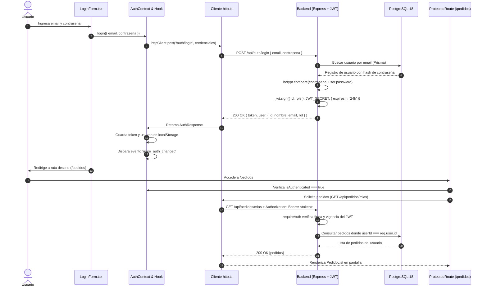

# NOIRÉ — Haute Parfumerie (Cliente Web Next.js)

> **Entrega 3 · Desarrollo Web (Semestre 2026-2)**  
> Plataforma de comercio electrónico y exhibición exclusiva de fragancias de nicho y diseñador, construida con arquitectura desacoplada full-stack en **Next.js 16 (App Router)**, **TypeScript** y **Tailwind CSS**.

---

## 🌐 Enlaces de Despliegue en Producción

| Entorno / Servicio | Plataforma | Enlace Oficial |
| :--- | :--- | :--- |
| **Frontend (Cliente Next.js)** | Vercel | [https://proyecto-semestral.vercel.app](https://proyecto-semestral.vercel.app) |
| **Backend (API REST Express)** | Render / Railway | [https://desarrollo-web-entrega-3-backend.onrender.com/api](https://desarrollo-web-entrega-3-backend.onrender.com/api) |
| **Repositorio Frontend** | GitHub | [https://github.com/PGSebas/desarrollo_web_entrega_3_frontend](https://github.com/PGSebas/desarrollo_web_entrega_3_frontend) |
| **Repositorio Backend** | GitHub | [https://github.com/PGSebas/desarrollo_web_entrega_3_backend](https://github.com/PGSebas/desarrollo_web_entrega_3_backend) |

---

## ⚜️ De Dónde Partimos: Evolución del Dominio

Continuando de forma estricta el dominio de la **Entrega 1** (*Noiré Perfumes*), la plataforma evoluciona de un sitio estático tradicional a una aplicación web moderna de alta fidelidad:

| Aspecto | Entrega 1 (Sitio Estático) | Entrega 3 (Full-Stack Desacoplado) |
| :--- | :--- | :--- |
| **Tecnología UI** | HTML5 semántico, CSS3 puro y JavaScript Vanilla. | **Next.js 16 (App Router)**, React 19, TypeScript y Tailwind CSS. |
| **Catálogo** | Arreglo en memoria local en `app.js`. | Catálogo persistido en **PostgreSQL 18** servido por API REST paginada (`GET /api/perfumes`). |
| **Interacción** | Formulario que capturaba datos y mostraba un JSON en alerta. | Checkout real autenticado que persiste pedidos en base de datos (`POST /api/pedidos`). |
| **Acceso & Roles** | Todo el contenido era público e indiscriminado. | Autenticación basada en **JWT**, sesión persistente y control de acceso basado en roles (`USER` y `ADMIN`). |
| **Diseño Visual** | Paleta oscura Noiré con fuentes tipográficas Playfair Display y Montserrat. | Sistema de diseño Noiré con soporte para tema claro/oscuro, microinteracciones y feedback de carga/error. |

---

## 🚀 Guía de Instalación y Ejecución en Local

### 1. Requisitos Previos
- **Node.js**: Versión 18.18.0 o superior (recomendado Node 20 LTS).
- **Gestor de Paquetes**: `npm` v9+ o `pnpm`.
- **Backend Activo**: La API REST del backend debe estar corriendo localmente (puerto `4000`) o en la nube para permitir el consumo de datos y autenticación.

### 2. Clonación e Instalación de Dependencias
```bash
# Clonar el repositorio
git clone https://github.com/PGSebas/desarrollo_web_entrega_3_frontend.git
cd desarrollo_web_entrega_3_frontend

# Instalar dependencias
npm install
```

### 3. Configuración de Variables de Entorno
Crea un archivo `.env.local` en la raíz del proyecto basándote en la plantilla `.env.example`:

```bash
cp .env.example .env.local
```

Contenido de `.env.local`:
```env
# URL base de la API REST del backend (sin pleca final)
NEXT_PUBLIC_API_HOST=http://localhost:4000/api
```

> **Nota para producción**: En Vercel, esta variable se configura como `NEXT_PUBLIC_API_HOST=https://desarrollo-web-entrega-3-backend.onrender.com/api`.

### 4. Scripts del Proyecto
| Comando | Descripción |
| :--- | :--- |
| `npm run dev` | Inicia el servidor de desarrollo local con Turbopack en `http://localhost:3000`. |
| `npm run build` | Ejecuta la verificación estricta de tipos de TypeScript y compila el bundle de producción optimizado. |
| `npm run start` | Arranca el servidor web en modo producción a partir del build generado. |
| `npm run lint` | Ejecuta el linter ESLint para análisis estático del código fuente. |

---

## 🔑 Credenciales de Prueba y Matriz de Roles

Para la evaluación académica de la entrega, se proporcionan dos cuentas preconfiguradas directamente en el `seed` del backend:

### 1. Cuentas de Acceso

| Rol | Correo Electrónico | Contraseña | Propósito de Prueba |
| :--- | :--- | :--- | :--- |
| **Administrador (`ADMIN`)** | `admin@noireperfumes.co` | `Admin123*` | Acceso irrestricto al panel `/admin`, métricas financieras, auditoría de todos los pedidos y CRUD de perfumes. |
| **Cliente (`USER`)** | `cliente@noireperfumes.co` | `Cliente123*` | Navegación, compra y checkout de fragancias (`/pedidos/nuevo`) y seguimiento en `/pedidos`. Acceso denegado a `/admin`. |

> **Acceso Rápido**: En la pantalla de login (`/login`), se han dispuesto botones de ayuda rápida para autocompletar estas credenciales con un solo clic.

### 2. Matriz de Control de Acceso (Frontend & Backend)

| Funcionalidad / Ruta | Invitado (Público) | Cliente (`USER`) | Administrador (`ADMIN`) |
| :--- | :---: | :---: | :---: |
| Explorar catálogo de fragancias (`/`, `GET /perfumes`) | ✅ Sí | ✅ Sí | ✅ Sí |
| Paginación y filtrado por colección/tipo | ✅ Sí | ✅ Sí | ✅ Sí |
| Iniciar sesión y registro (`/login`, `/registro`) | ✅ Sí | Redirige al inicio | Redirige al inicio |
| Solicitar pedido / Checkout (`/pedidos/nuevo`) | ❌ Redirige a `/login` | ✅ Autorizado | ✅ Autorizado |
| Ver historial personal de pedidos (`/pedidos`) | ❌ Redirige a `/login` | ✅ Solo los propios | ✅ Solo los propios |
| Panel de administración (`/admin`) | ❌ Redirige a `/login` | ⛔ 403 / Acceso Restringido | ✅ Autorizado |
| Auditoría global de pedidos (`GET /pedidos`) | ❌ 401 Unauthorized | ⛔ 403 Forbidden | ✅ Autorizado |
| CRUD del catálogo (`POST/PUT/DELETE /perfumes`) | ❌ 401 Unauthorized | ⛔ 403 Forbidden | ✅ Autorizado |

---

## 🧠 Decisiones Técnicas y Respuestas a la Rúbrica

A continuación se detallan las respuestas técnicas oficiales requeridas para la calificación de la entrega:

### 1. Flujo Completo de un Login: De Formulario a Ruta Protegida



1. **Envío de credenciales**: El usuario diligencia su email y contraseña en `LoginForm.tsx` y envía el formulario.
2. **Invocación del servicio**: El formulario invoca `login()` provisto por `AuthContext`, el cual llama a `authService.login()` y éste al cliente centralizado `http.ts`.
3. **Validación criptográfica en backend**: La API recibe el `POST /api/auth/login`. Busca al usuario en PostgreSQL mediante Prisma y compara el hash usando `bcrypt.compare`.
4. **Firma del JWT**: Al validar la coincidencia, el backend firma un JSON Web Token con la clave secreta `JWT_SECRET` y una expiración de 24 horas. El payload lleva estrictamente `{ id, role }`, sin contraseñas ni datos sensibles.
5. **Persistencia en el cliente**: Al recibir el token, el frontend lo almacena en `localStorage` bajo la clave `noire_token` y emite un evento personalizado `noire_auth_changed` para sincronizar la UI (barra de navegación, menú de usuario) de forma reactiva y sin recargar la página.
6. **Validación en Ruta Protegida**: Cuando el usuario navega a `/pedidos` o `/pedidos/nuevo`, el componente guardián `ProtectedRoute.tsx` verifica si existe una sesión válida. Si no existe, redirige a `/login?redirect=...`.
7. **Inyección automática del token**: Toda llamada a la API que realiza la página protegida pasa por `httpClient`, el cual recupera el token de `localStorage` y adjunta la cabecera HTTP `Authorization: Bearer <token>`.
8. **Autorización en el servidor**: El middleware `requireAuth` intercepta la petición, verifica criptográficamente el JWT con `jwt.verify`, extrae el `id` y `role`, e inyecta la información en `req.user`. La interacción se procesa y el backend responde con los datos correspondientes.

---

### 2. ¿Dónde se guarda el token en el frontend y qué riesgo tiene esa decisión?

En esta aplicación, el token JWT se almacena en el **`localStorage`** del navegador (`localStorage.setItem('noire_token', token)`).

#### Análisis de Riesgos y Justificación
- **Principal Riesgo (Vulnerabilidad a XSS - Cross-Site Scripting)**: Cualquier script JavaScript malicioso que logre ejecutarse en el contexto de la aplicación (por ejemplo, a través de una dependencia npm comprometida en la cadena de suministro o una inyección de contenido no saneado) tiene acceso total al almacenamiento local mediante `localStorage.getItem('noire_token')`. El atacante puede exfiltrar el token hacia un servidor externo y suplantar la identidad del usuario durante la vigencia del mismo.
- **Alternativa más segura en producción (Cookies `HttpOnly`)**: La alternativa recomendada por OWASP es emitir el JWT en una cookie con las banderas:
  - `HttpOnly`: Impide que cualquier código JavaScript en el navegador pueda leer o manipular la cookie, neutralizando por completo el robo de tokens por XSS.
  - `Secure`: Garantiza que la cookie solo viaje sobre canales cifrados HTTPS.
  - `SameSite=Strict` o `SameSite=Lax`: Previene ataques de falsificación de peticiones en sitios cruzados (CSRF).
- **Medidas de mitigación adoptadas en Noiré**:
  - El payload del JWT contiene únicamente el identificador y el rol (`{ id, role }`), sin datos sensibles.
  - El token cuenta con tiempo de expiración definido (`JWT_EXPIRES_IN=24h`).
  - No se almacena ninguna información financiera sensible en el frontend ni en el token.
  - Se utiliza sanitización estricta y se evitan inserciones directas de HTML no controlado.

---

### 3. ¿En qué caso tu API responde 401 y en cuál 403? Ejemplos Reales de la Aplicación

La diferencia fundamental radica en **autenticación (quién eres)** frente a **autorización (qué tienes permitido hacer)**:

#### Caso 401: Unauthorized (Falta de Autenticación o Token Inválido)
El código de estado `401 Unauthorized` se emite cuando la petición carece de credenciales de autenticación válidas o el token provisto es nulo, está malformado, fue alterado o ha expirado.
- **Ejemplo real en Noiré**:
  - Un usuario anónimo o un visitante no autenticado intenta crear un pedido enviando una petición `POST /api/pedidos` sin la cabecera `Authorization: Bearer <token>`.
  - El middleware centralizado `requireAuth` evalúa la cabecera, comprueba que el token no fue provisto y rechaza de inmediato la petición con código `401 Unauthorized` y el mensaje `"Token de autenticación no provisto o inválido"`.
  - En el frontend, el cliente `http.ts` detecta este código `401`, limpia el almacenamiento de sesión (`localStorage`) y redirige automáticamente al usuario a `/login?expired=true`.

#### Caso 403: Forbidden (Falta de Permisos / Rol Insuficiente)
El código de estado `403 Forbidden` se emite cuando el usuario **sí está autenticado** con un token completamente válido y vigente, pero su rol o nivel de privilegios **no le otorga autorización** para acceder al recurso solicitado.
- **Ejemplo real en Noiré**:
  - Un cliente registrado con rol regular `USER` (`cliente@noireperfumes.co`) inicia sesión normalmente (obteniendo un token JWT válido con payload `{ id: 2, role: "USER" }`).
  - Si este usuario intenta consultar la auditoría global de todas las compras de la plataforma mediante `GET /api/pedidos` o intenta eliminar un perfume mediante `DELETE /api/perfumes/1`, la petición supera con éxito el middleware `requireAuth` (porque el token es válido y no es 401), pero al llegar al middleware `requireAdmin`, éste comprueba que `req.user.role !== 'ADMIN'`.
  - El servidor responde `403 Forbidden` con el mensaje: `"Acceso denegado: se requieren privilegios de administrador"`. El usuario está autenticado, pero no tiene el rol necesario.

---

## 🏛️ Arquitectura Modular por Features

El proyecto implementa la arquitectura por **features** recomendada en clase, desacoplando completamente la lógica de negocio, los modelos de dominio, el consumo HTTP y la presentación visual:

```
src/
├── app/                              # Rutas del App Router (solo composición)
│   ├── layout.tsx                    # RootLayout con AuthProvider y script anti-parpadeo de tema
│   ├── page.tsx                      # Catálogo principal con filtros y paginación
│   ├── not-found.tsx                 # Página 404 personalizada con estética Noiré
│   ├── login/
│   │   └── page.tsx                  # Pantalla de inicio de sesión
│   ├── registro/
│   │   └── page.tsx                  # Pantalla de registro de nuevos clientes
│   ├── pedidos/
│   │   ├── page.tsx                  # Historial de pedidos personales (ruta protegida)
│   │   └── nuevo/
│   │       └── page.tsx              # Checkout y solicitud de compra (ruta protegida)
│   └── admin/
│       └── page.tsx                  # Panel administrativo exclusivo para rol ADMIN
└── features/                         # Módulos desacoplados por dominio
    ├── common/                       # Infraestructura transversal
    │   ├── config.ts                 # API_BASE_URL resuelta desde NEXT_PUBLIC_API_HOST
    │   ├── http.ts                   # Cliente HTTP centralizado (Bearer token, 401 redirect, get/post/put/delete)
    │   └── components/               # Componentes UI base (Navbar, Footer, Hero, Button, Input, Badge, Pagination, ThemeToggle)
    ├── auth/                         # Feature: Autenticación & Sesión
    │   ├── domain/                   # Modelos: User, AuthResponse, LoginDto, RegisterDto
    │   ├── services/                 # authService (login, register, logout, getStoredSession)
    │   ├── context/                  # AuthContext (proveedor global de sesión reactiva)
    │   ├── hooks/                    # useAuth (hook de consumo de contexto)
    │   └── components/               # LoginForm, RegisterForm, ProtectedRoute
    ├── perfumes/                     # Feature: Catálogo de Fragancias
    │   ├── domain/                   # Modelos: Perfume, PerfumeFilters, PaginatedPerfumes
    │   ├── services/                 # perfumeService (getAll, getById, create, update, delete)
    │   ├── hooks/                    # usePerfumes (carga con paginación, filtros y recarga)
    │   └── components/               # PerfumeCard, PerfumeGrid, PerfumeFilters, PerfumeSkeleton
    ├── pedidos/                      # Feature: Interacción / Pedidos
    │   ├── domain/                   # Modelos: Pedido, CreatePedidoDto, PedidoStatus
    │   ├── services/                 # pedidoService (create, getMias, getAll)
    │   ├── hooks/                    # usePedidos, useCreatePedido
    │   └── components/               # PedidoForm, PedidoCard, PedidoList
    └── admin/                        # Feature: Gestión Administrativa
        ├── services/                 # adminService (getAllPedidos, getAllPerfumes, CRUD)
        ├── hooks/                    # useAdminData (KPIs, orquestación de datos y borrado)
        └── components/               # AdminStats, AdminPedidosTable, AdminPerfumesTable, PerfumeModalForm
```

---

## 🎨 Sistema de Diseño Noiré Haute Parfumerie

- **Tipografía Editorial**: `Playfair Display` para títulos y logotipos de alta gama, y `Montserrat` para textos técnicos, descripciones y microcopia.
- **Paleta de Colores de Lujo**:
  - Acento Dorado Noiré: `#D4AF37` / `#C5A059`
  - Fondo Obsidiana Profundo: `#0B0B0C` (Dark Mode) y Mármol Suave `#F8F6F2` (Light Mode)
  - Vino Granate Real: `#8B0E1A` para botones principales de compra y llamados a la acción.
- **Soporte de Tema Dual**: Alternador reactivo de modo claro/oscuro persistido en `localStorage` con script de hidratación temprana en `<head>` para evitar parpadeos visuales (*FOUC*).

---

## 👤 Autoría y Créditos
- **Estudiante**: Sebastián Pineda González
- **Materia**: Desarrollo Web — Semestre 2026-2
- **Proyecto Semestral**: Entrega 3 (Full-Stack Decoupled Architecture)